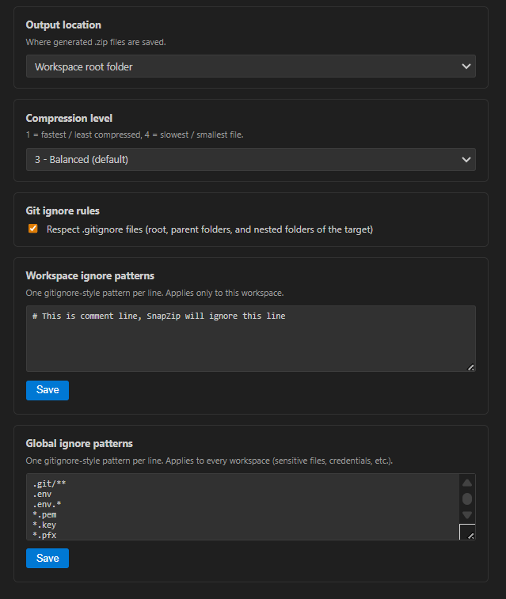

# SnapZip

[](https://www.npmjs.com/package/@the-long-ride/snapzip)
[](https://marketplace.visualstudio.com/items?itemName=the-long-ride.snapzip)
[](https://open-vsx.org/extension/the-long-ride/snapzip)
[](https://github.com/the-long-ride/SnapZip/actions/workflows/ci.yml)
[](https://github.com/the-long-ride/SnapZip/blob/main/LICENSE)

Right-click or command-line compression with smart, `.gitignore`-aware rules, per-workspace settings, and global ignore defaults.

SnapZip is available as both:
1. **[Terminal CLI / NPX Executable](#cli--npx-usage-terminal--scripts)** — instant folder archiving for CI/CD, scripts, and command-line workflows.
2. **[VS Code & IDE Extension](#vs-code--ide-extension)** — right-click context menu and keyboard shortcuts for VS Code, VSCodium, Cursor, Windsurf, and Eclipse Theia.

---

## CLI / NPX Usage (Terminal & Scripts)

Run SnapZip directly from the terminal without installing, or install globally via npm:

### Instant Execution with NPX

```bash
# Compress the current working directory
npx @the-long-ride/snapzip

# Compress a specific directory
npx @the-long-ride/snapzip path/to/folder

# Custom output directory and maximum compression
npx @the-long-ride/snapzip my-app --output ./dist --level 4

# Pass custom ignore patterns and disable .gitignore rules
npx @the-long-ride/snapzip my-app --ignore "*.log,temp/" --no-gitignore

# Load ignore rules from a custom config file
npx @the-long-ride/snapzip my-app --config ./snapzip.config.json
```

### Global Installation

```bash
npm install -g @the-long-ride/snapzip

# Then use 'snapzip' anywhere:
snapzip path/to/folder
```

### CLI Command-Line Options

| Option | Shorthand | Description | Default |
|---|---|---|---|
| `[folder]` | — | Target folder path to compress | `.` (current directory) |
| `--output <dir>` | `-o` | Destination directory for the `.zip` archive | Parent folder of target |
| `--level <0..4>` | `-l` | Compression level (`0`=Store, `1`=Fast, `2`=Low, `3`=Medium, `4`=Max) | `3` |
| `--ignore <pat>` | `-i` | Additional ignore patterns (repeatable or comma-separated) | `[]` |
| `--no-gitignore` | — | Disable automatic scanning of `.gitignore` files | Enabled |
| `--config <file>` | `-c` | Path to custom config file (JSON or line-separated) | Auto-resolved |
| `--version` | `-v` | Display version number | — |
| `--help` | `-h` | Show CLI usage instructions | — |

### Configuration Discovery

The CLI automatically detects and merges your ignore patterns from:
- `.vscode/settings.json` (`snapZip.ignore.workspacePatterns` and `snapZip.ignore.global`)
- `.snapzipignore` (in workspace root and target folder)
- `~/.snapziprc` (user global config: JSON or line-separated patterns)
- `--config <path>` (explicit custom config file)

---

## VS Code & IDE Extension

Install SnapZip in your favorite editor:
- **VS Code / Cursor / Windsurf**: [Install from VS Code Marketplace](https://marketplace.visualstudio.com/items?itemName=the-long-ride.snapzip)
- **VSCodium / Eclipse Theia / Gitpod**: [Install from Open VSX Registry](https://open-vsx.org/extension/the-long-ride/snapzip)
- **Manual VSIX Installation**:
  ```bash
  code --install-extension snapzip-1.0.6.vsix
  # or in Open VSX:
  ovx get the-long-ride.snapzip
  ```



### Extension Features & Shortcuts

| Where | What | Shortcut |
|---|---|---|
| Explorer, right-click or focus on any folder | **Compress as .zip** | `Ctrl+Alt+Z` (macOS: `Cmd+Alt+Z`) |
| Explorer view title bar (icon) | **Compress Workspace as .zip** — zips every workspace root folder | — |
| Command Palette | **SnapZip: Open Settings** — visual UI to configure output location, compression level, and ignore patterns | — |

### Managing Patterns in VS Code

| Command | Purpose |
|---|---|
| `SnapZip: Open Settings` | Open visual settings panel |
| `SnapZip: Add Ignore Pattern (This Workspace)` | Add one pattern to current workspace |
| `SnapZip: Add Ignore Pattern (Global, All Workspaces)` | Add one pattern for every workspace |
| `SnapZip: Manage Ignore Patterns` | View or remove existing patterns |
| `SnapZip: Copy Workspace Ignore Patterns to Clipboard` | Export patterns as JSON |
| `SnapZip: Paste/Apply Ignore Patterns From Clipboard to This Workspace` | Import patterns from JSON into workspace |

---

## Ignore Rules (Combined in Priority Order)

1. **Global patterns** (`snapZip.ignore.global`) — applies everywhere; ships with sensible defaults for secrets (`.env`, `*.pem`, `id_rsa`, `.ssh/**`, `.git/**`) and common build outputs (`node_modules/`, `dist/`, `build/`, `out/`, `target/`).
2. **Workspace patterns** (`snapZip.ignore.workspacePatterns`) — custom globs scoped to the current project/workspace.
3. **`.gitignore` files** (toggle: `snapZip.ignore.useGitignore`, default on) — root `.gitignore`, parent-folder `.gitignore`, and nested `.gitignore` files.

*Note: Lines starting with `#` are treated as comments. Negation patterns (`!`) are fully supported to re-include specific files or folders.*

---

## Output Location

`snapZip.output.location`:
- `parentFolder` (default) — zip is saved alongside the folder being compressed.
- `workspaceRoot` — zip is saved in the root of the workspace.

---

## Links & License

| Resource | Link |
|---|---|
| **VS Code Marketplace** | [SnapZip on VS Code Marketplace](https://marketplace.visualstudio.com/items?itemName=the-long-ride.snapzip) |
| **Open VSX Registry** | [SnapZip on Open VSX](https://open-vsx.org/extension/the-long-ride/snapzip) |
| **npm Package** | [@the-long-ride/snapzip on npm](https://www.npmjs.com/package/@the-long-ride/snapzip) |
| **Author** | [the-long-ride](https://github.com/the-long-ride) |
| **Repository** | [github.com/the-long-ride/SnapZip](https://github.com/the-long-ride/SnapZip) |
| **Issue Tracker** | [GitHub Issues](https://github.com/the-long-ride/SnapZip/issues) |
| **Changelog** | [CHANGELOG.md](https://github.com/the-long-ride/SnapZip/blob/main/CHANGELOG.md) |
| **License** | [MIT License](https://github.com/the-long-ride/SnapZip/blob/main/LICENSE) |
