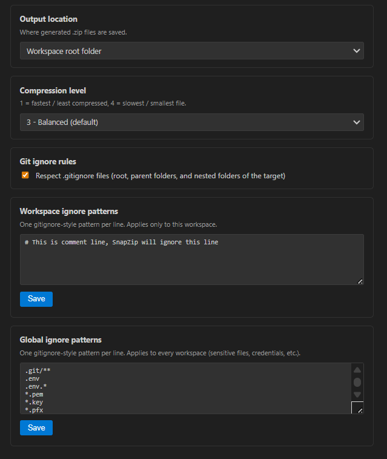

# SnapZip

Right-click compression for VS Code / VSCodium, with `.gitignore`-aware, per-workspace and global ignore rules.

## Features

| Where | What |
|---|---|
| Explorer, right-click any folder | **Compress as .zip** |
| Explorer view title bar (icon) | **Compress Workspace as .zip** — zips every workspace root folder |
| Command Palette | **SnapZip: Open Settings** — visual UI to configure output location, compression level, and ignore patterns |

## Ignore rules (in priority order, all combined)

1. **Global patterns** (`snapZip.ignore.global`) — applies to every workspace, ships with sensible defaults for secrets (`.env`, `*.pem`, `id_rsa`, `.ssh/**`, `.git/**`, etc.) and common build folders (`node_modules/`, `dist/`, `build/`, `out/`, `target/`, etc.)
2. **Workspace patterns** (`snapZip.ignore.workspacePatterns`) — custom globs, scoped to the current workspace only
3. **`.gitignore` files** (toggle: `snapZip.ignore.useGitignore`, default on) — root `.gitignore`, `.gitignore` in every parent folder of the target, and any nested `.gitignore` files inside the folder being zipped

*Note: In all pattern lists and settings UI, lines starting with `#` are treated as comments and ignored.*

## Output location

`snapZip.output.location`:
- `parentFolder` (default) — zip is saved next to the folder being compressed
- `workspaceRoot` — zip is always saved in the workspace root

## Managing patterns

| Command | Purpose |
|---|---|
| `SnapZip: Open Settings` | open visual settings panel |
| `SnapZip: Add Ignore Pattern (This Workspace)` | add one pattern to this workspace |
| `SnapZip: Add Ignore Pattern (Global, All Workspaces)` | add one pattern for every workspace |
| `SnapZip: Manage Ignore Patterns` | view/remove existing patterns |
| `SnapZip: Copy Workspace Ignore Patterns to Clipboard` | clone patterns out |
| `SnapZip: Paste/Apply Ignore Patterns From Clipboard to This Workspace` | clone patterns into another workspace |

Global patterns live in user settings (`settings.json`), so they apply everywhere automatically. Workspace patterns live in `.vscode/settings.json`, so the copy/paste commands are there for moving them between projects manually.

## Notes / limitations

- `.gitignore` scoping is a close approximation of git's real per-directory precedence (handles anchored `/path`, plain names matching any depth, and negation `!`) — good enough for export purposes, not a full git implementation.
- Symlinks are archived as their target file content.

## Links & License

| Resource | Link |
|---|---|
| **VS Code Marketplace** | [SnapZip on VS Code Marketplace](https://marketplace.visualstudio.com/items?itemName=the-long-ride.snapzip) |
| **Open VSX Registry** | [SnapZip on Open VSX](https://open-vsx.org/extension/the-long-ride/snapzip) |
| **Author** | [the-long-ride](https://github.com/the-long-ride) |
| **Repository** | [github.com/the-long-ride/SnapZip](https://github.com/the-long-ride/SnapZip) |
| **Issue Tracker** | [GitHub Issues](https://github.com/the-long-ride/SnapZip/issues) |
| **Changelog** | [CHANGELOG.md](https://github.com/the-long-ride/SnapZip/blob/main/CHANGELOG.md) |
| **License** | [MIT License](https://github.com/the-long-ride/SnapZip/blob/main/LICENSE) |
